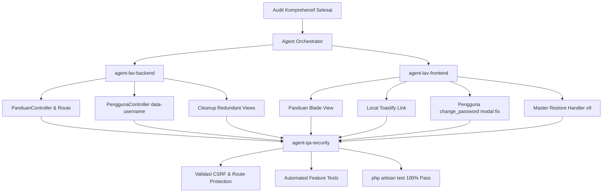

# Audit Komprehensif Fungsional & UI Project TKBM-LAV

Dokumen ini memuat hasil audit menyeluruh terhadap 39 modul dan halaman pada project Laravel 11 (`tkbm-lav`) dengan acuan referensi sistem CodeIgniter 3 (`tkbm`). Setiap temuan dilengkapi dengan tingkat keparahan (*severity*), rujukan kode CI3, dan rencana delegasi perbaikan ke sub-agent terspesialisasi.

---

## 1. Matriks Status Audit per Modul

| # | Modul / Halaman | Routing & Controller | UI Blade View | Action Buttons & AJAX | Status | Catatan Audit |
|---|---|:---:|:---:|:---:|:---:|---|
| 1 | **Dashboard** | ✅ OK | ✅ OK | ✅ OK | **PASSED** | Statistik cards, shortcuts, quick filter berjalan normal. |
| 2 | **Auth (Login/Logout)** | ✅ OK | ✅ OK | ✅ OK | **PASSED** | Form login, validation, session, remember-me berfungsi. |
| 3 | **Profile** | ✅ OK | ✅ OK | ✅ OK | **PASSED** | Edit profil, avatar, simpan password berfungsi. |
| 4 | **Master Aktifitas** | ✅ OK | ✅ OK | ⚠️ Issue | **ACTION REQUIRED** | Tombol Restore terhapus belum ada event listener di JS. |
| 5 | **Master Alat** | ✅ OK | ✅ OK | ⚠️ Issue | **ACTION REQUIRED** | Tombol Restore terhapus belum ada event listener di JS. |
| 6 | **Master Catatan** | ✅ OK | ✅ OK | ⚠️ Issue | **ACTION REQUIRED** | Tombol Restore terhapus belum ada event listener di JS. |
| 7 | **Master Client** | ✅ OK | ✅ OK | ⚠️ Issue | **ACTION REQUIRED** | Tombol Restore terhapus belum ada event listener di JS. |
| 8 | **Master Dermaga** | ✅ OK | ✅ OK | ⚠️ Issue | **ACTION REQUIRED** | Tombol Restore terhapus belum ada event listener di JS. |
| 9 | **Master Kapal** | ✅ OK | ✅ OK | ⚠️ Issue | **ACTION REQUIRED** | Tombol Restore terhapus belum ada event listener di JS. |
| 10 | **Master KRK** | ✅ OK | ✅ OK | ⚠️ Issue | **ACTION REQUIRED** | Tombol Restore terhapus belum ada event listener di JS. |
| 11 | **Master Pelabuhan** | ✅ OK | ✅ OK | ⚠️ Issue | **ACTION REQUIRED** | Tombol Restore terhapus belum ada event listener di JS. |
| 12 | **Master Satuan** | ✅ OK | ✅ OK | ⚠️ Issue | **ACTION REQUIRED** | Tombol Restore terhapus belum ada event listener di JS. |
| 13 | **Master Email Template** | ✅ OK | ✅ OK | ⚠️ Issue | **ACTION REQUIRED** | Terdapat file view usang dan sisa file legacy `.php`. |
| 14 | **Work Order (WO)** | ✅ OK | ✅ OK | ✅ OK | **PASSED** | Filter tanggal, status 4 tahap, modal detail, print cetak SPK, restore OK. |
| 15 | **Report Work Order** | ✅ OK | ✅ OK | ✅ OK | **PASSED** | Filter rekap per kapal/periode, export data, cetak rekap kegiatan kapal OK. |
| 16 | **Accounting: Invoice List** | ✅ OK | ✅ OK | ✅ OK | **PASSED** | DataTables, filter status pembayaran, create, detail, print invoice OK. |
| 17 | **Accounting: Invoice Detail** | ✅ OK | ✅ OK | ✅ OK | **PASSED** | Konfirmasi bayar (modal + upload bukti), mark sent, cancel invoice OK. |
| 18 | **Accounting: Invoice Form** | ✅ OK | ✅ OK | ✅ OK | **PASSED** | Dynamic multi-row calculation (subtotal, PPN, total tagihan) OK. |
| 19 | **Activity: Index & Search** | ✅ OK | ✅ OK | ✅ OK | **PASSED** | Filter tanggal/status, visual card list, progress WO OK. |
| 20 | **Activity: Form Detail** | ✅ OK | ✅ OK | ✅ OK | **PASSED** | Dynamic multi-row activity input, camera/file upload, modal quick add KRK OK. |
| 21 | **Activity: List Detail** | ✅ OK | ✅ OK | ✅ OK | **PASSED** | View detail item, lightbox image preview, delete detail with SweetAlert2 OK. |
| 22 | **Pengaturan: Aplikasi** | ✅ OK | ✅ OK | ✅ OK | **PASSED** | Tab General, Theme, Mail, Security, upload logo & favicon, export/import OK. |
| 23 | **Pengaturan: Roles** | ✅ OK | ✅ OK | ✅ OK | **PASSED** | CRUD roles, permission matrix mapping OK. |
| 24 | **Pengaturan: Pengguna** | ✅ OK | ✅ OK | ⚠️ Issue | **ACTION REQUIRED** | Tombol Ubah Password membaca atribut `data-username` yang tidak diset controller (`undefined`). |
| 25 | **Pengaturan: Menu** | ✅ OK | ✅ OK | ✅ OK | **PASSED** | Sortable drag-and-drop urutan menu, simpan AJAX OK. |
| 26 | **Pengaturan: Akses** | ✅ OK | ✅ OK | ✅ OK | **PASSED** | Permission mapping matrix per grup dan role OK. |
| 27 | **Pengaturan: Cron** | ✅ OK | ✅ OK | ✅ OK | **PASSED** | Daftar task cron, toggle aktif/nonaktif, run manual, execution logs OK. |
| 28 | **Logs: User Activity** | ✅ OK | ✅ OK | ✅ OK | **PASSED** | Table audit trail, filter date range/action, modal detail JSON OK. |
| 29 | **Logs: API Request** | ✅ OK | ✅ OK | ✅ OK | **PASSED** | Logging request/response payload, HTTP status code filter, modal detail OK. |
| 30 | **Logs: Email** | ✅ OK | ✅ OK | ✅ OK | **PASSED** | Statistik email, status filter, modal preview pesan, tombol resend email OK. |
| 31 | **Logs: Errors** | ✅ OK | ✅ OK | ✅ OK | **PASSED** | Tracking exception & stack trace, tombol Resolve error dengan SweetAlert2 OK. |
| 32 | **Dokumentasi: Panduan** | ❌ 404 | ❌ Missing | ❌ Broken | **CRITICAL** | Sidebar menu `/panduan` mengarah ke 404 karena Controller, Route, dan View belum ada. |
| 33 | **Layouts: Core Head & Scripts** | ⚠️ CDN | ⚠️ Missing CSS | ⚠️ Issue | **ACTION REQUIRED** | Toastify CSS belum dilink di `<head>` dan Toastify JS bergantung pada CDN eksternal. |
| 34-39 | **Mobile API Endpoints (v1)** | ✅ OK | N/A | ✅ OK | **PASSED** | Auth, workorder list/detail, update report, offline sync, submit batch (60 unit tests pass). |

---

## 2. Rincian Temuan Issue & Rencana Aksi

### Issue #1: Dead Link 404 pada Navigasi Panduan Pengguna (Severity: CRITICAL)
- **Lokasi Terpengaruh**: `resources/views/layouts/menu.blade.php` (baris 207).
- **Deskripsi Masalah**: Navigasi sidebar menu pada bagian "DOKUMENTASI" memiliki tautan `<a href="{{ url('panduan') }}">`. Namun, route `/panduan` belum didaftarkan di `routes/web.php`, belum ada `PanduanController.php`, dan belum ada view `resources/views/panduan.blade.php`. Mengklik tombol ini langsung menghasilkan error 404.
- **Rujukan CodeIgniter 3**:
  - Controller: `d:\www\tkbm\application\controllers\Panduan.php` (menangani log activity dan view data).
  - View: `d:\www\tkbm\application\views\panduan.php` (halaman panduan interaktif 950 baris yang kaya fitur: Maker-Checker workflow, tab Admin Web Panel, tab Mobile App Pengawas, dan interactive search bar).
- **Sub-Agent Delegasi**:
  - `agent-lav-backend`: Buat `app/Http/Controllers/PanduanController.php` dan daftarkan `Route::get('/panduan', [PanduanController::class, 'index'])->name('panduan');` di `routes/web.php`.
  - `agent-lav-frontend`: Porting `panduan.php` ke Blade template `resources/views/panduan.blade.php` lengkap dengan integrasi asset modern dan search filter.
  - `agent-qa-security`: Buat Feature Test untuk memastikan route `/panduan` merespons HTTP 200 untuk user terautentikasi dan redirect 302 untuk guest.

---

### Issue #2: Ketergantungan CDN Eksternal & CSS Toastify Hilang (Severity: HIGH)
- **Lokasi Terpengaruh**: `resources/views/layouts/app.blade.php` (baris 35-50, 202-230) dan `public/assets/js/plugins.js`.
- **Deskripsi Masalah**:
  1. File `resources/views/layouts/app.blade.php` tidak memuat `<link rel="stylesheet" href="...toastify.css">` di `<head>`.
  2. File `public/assets/js/plugins.js` memuat library `Toastify` melalui `document.writeln` dari CDN eksternal `https://cdn.jsdelivr.net/npm/toastify-js` hanya jika ditemukan elemen bertanda khusus di body saat runtime awal.
  3. Di sisi lain, helper notifikasi sistem pada `public/assets/js/custom.js` (`toast_success()`, `toast_error()`, `toast_warning()`) langsung mengeksekusi `Toastify({...})`.
  4. Ketika aplikasi dijalankan offline (local dev / server intranet pelabuhan), atau bila koneksi CDN terblokir, notifikasi toast gagal tampil atau memicu error `Toastify is not defined`.
  5. Aset lokal sebenarnya sudah tersedia lengkap di `public/assets/libs/toastify-js/src/toastify.js` dan `public/assets/libs/toastify-js/src/toastify.css`.
- **Sub-Agent Delegasi**:
  - `agent-lav-frontend`: Sertakan `toastify.css` lokal di `<head>` dan muat `toastify.js` lokal secara konsisten di `layouts/app.blade.php`.

---

### Issue #3: Tombol "Ubah Password" Pengguna Menampilkan "Pengguna: undefined" (Severity: HIGH)
- **Lokasi Terpengaruh**:
  - `app/Http/Controllers/Pengaturan/PenggunaController.php` (baris 90).
  - `resources/views/pengaturan/pengguna/index.blade.php` (baris 386-398).
- **Deskripsi Masalah**:
  1. Pada tabel DataTables Pengguna, tombol aksi Ubah Password (`.btn-change-password`) di-render oleh controller dengan atribut `data-title="' . e($btnName) . '"`.
  2. Namun, event handler JavaScript di `index.blade.php` membaca `let username = $(this).data('username');`. Akibatnya, `username` menjadi `undefined`, dan judul modal menampilkan `"Pengguna: undefined"`.
- **Sub-Agent Delegasi**:
  - `agent-lav-backend`: Tambahkan atribut `data-username="' . e($btnName) . '"` pada tombol aksi di `PenggunaController.php`.
  - `agent-lav-frontend`: Update handler di `index.blade.php` agar membaca `$(this).data('username') || $(this).data('title')`.

---

### Issue #4: Tombol "Restore" Data Terhapus Tidak Berfungsi di 9 Modul Master (Severity: HIGH)
- **Lokasi Terpengaruh**:
  - `resources/views/master/aktifitas/index.blade.php`
  - `resources/views/master/alat/index.blade.php`
  - `resources/views/master/catatan/index.blade.php`
  - `resources/views/master/client/index.blade.php`
  - `resources/views/master/dermaga/index.blade.php`
  - `resources/views/master/kapal/index.blade.php`
  - `resources/views/master/krk/index.blade.php`
  - `resources/views/master/pelabuhan/index.blade.php`
  - `resources/views/master/satuan/index.blade.php`
- **Deskripsi Masalah**:
  1. Ketika tombol "Tampilkan Data Terhapus" (`#btn_show_deleted`) diklik, DataTables me-reload data dan menampilkan baris data soft-deleted beserta tombol restore (`.btn-restore`).
  2. Controller dan route `POST /master/{module}/restore` sudah siap dan mendukung pemulihan data (`$model->restore()`).
  3. Namun, kesembilan view master di atas TIDAK memiliki event handler `$(document).on('click', '.btn-restore', ...)`.
  4. Akibatnya, saat pengguna mengklik tombol restore berwarna hijau, tidak ada respons apa pun di layar.
- **Rujukan Implementasi yang Berfungsi**:
  - `resources/views/workorder/index.blade.php` (baris 583-616) dan `resources/views/accounting/invoice/index.blade.php` (baris 258-282) yang sudah memiliki handler `.btn-restore` dengan konfirmasi dan reload DataTables.
- **Sub-Agent Delegasi**:
  - `agent-lav-frontend`: Tambahkan handler standar `$(document).on('click', '.btn-restore', ...)` pada seluruh 9 view master tersebut.

---

### Issue #5: Redundansi File Usang pada Modul Master Email (Severity: MEDIUM)
- **Lokasi Terpengaruh**:
  - `resources/views/master/email/` (`edit.blade.php`, `index.blade.php`, `show.php`)
  - `resources/views/master/email_template/` (`_form.php`, `_preview.php`)
- **Deskripsi Masalah**:
  1. `app/Http/Controllers/Master/EmailController.php` telah dimigrasi untuk menggunakan view folder `master.email_template.*` (`index.blade.php`, `_form.blade.php`, `_preview.blade.php`).
  2. Direktori `resources/views/master/email/` memuat mock view lama yang tidak dirouting.
  3. Direktori `resources/views/master/email_template/` masih menyisakan file template mentah CI3 (`_form.php` dan `_preview.php`) berdampingan dengan file Blade resminya.
- **Sub-Agent Delegasi**:
  - `agent-lav-backend`: Hapus file sisa dan redundan yang tidak digunakan agar struktur view bersih dan maintainable.

---

## 3. Rencana Eksekusi Perbaikan

